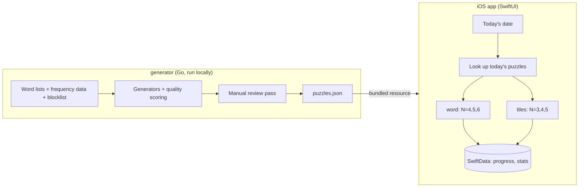

# N-grams design

Status: draft, nothing built yet (2026-10-19)

## Goal

Daily word puzzles on iPhone without ads, accounts, energy meters, or upsells. Two game types
modeled on games I already like (NYT Wordle and Apple News Quartiles), each offered at three
sizes, so N varies. Six puzzles a day, every day.

Personal use first. A public App Store release is not a goal for now (see [Distribution and legal](#distribution-and-legal)).

## Non-goals (for now)

- Accounts, sync, leaderboards, notifications.
- A puzzle archive or "play unlimited" mode.
- Live puzzle generation on the device.
- Monetization of any kind.

## Games

The originals' names are trademarks (WORDLE is NYT's, Quartiles is Apple's) and must not appear
in the app. In-app names are an open question. Internally the kinds are `word` and `tiles`.

| Kind    | Modeled on | Sizes (N)          | Daily puzzles |
| ------- | ---------- | ------------------ | ------------- |
| `word`  | Wordle     | 4, 5, 6 letters    | 3             |
| `tiles` | Quartiles  | 3, 4, 5 tiles/word | 3             |

### `word`

- Guess an N-letter word; each guess marks letters as correct, present, or absent.
- 6 guesses at every N to start. Shorter words are the trap-prone ones (BATE/DATE/FATE/GATE),
  so scaling guesses as N+1 would make the hardest variant harder. Tune by playing.
- Guesses must come from the accepted-guess list for that length.

### `tiles`

- A board of word fragments ("tiles"). Build words from 1 to N tiles, each tile used at most
  once per word, in order.
- Each board hides 5 target words of exactly N tiles that together use every tile.
- Board size scales with N: 15, 20, 25 tiles. The bigger N is the harder board. Holding the
  tile count near 20 instead (more targets at small N, fewer at large N) is the alternative;
  the generator prototype should produce both so the choice is made by looking at real boards.
- Scoring follows the original's shape: points grow with tile count, with a target score to
  reach. Verify the original's exact curve before borrowing it; tune from there.

### Shared

- The day rolls over at local midnight on the device.
- Results can be shared as an emoji summary (no spoilers).
- Stats and streaks are per `(kind, n)`.

## Architecture

The app plays puzzles; it never makes them. All generation and curation happens offline in a
Go tool, and the app ships with a pre-built puzzle bank.



### Repo layout

```text
generator/   Go module: word list processing, puzzle generation, bank output
ios/         Xcode project
data/        source word lists, blocklist, generated bank
docs/        this file
```

`make format lint test` targets arrive with the first code.

## Generator

### Word lists

- Dictionary: ENABLE (public domain). SCOWL (permissive) if ENABLE proves too sparse or too
  obscure. NYT's own lists are not usable.
- Commonness: a word frequency source (Google Books Ngram data fits the name) decides which
  words are fair as answers and targets.
- Blocklist: offensive words are excluded from answers and targets. They stay valid as guesses
  and as found words, since rejecting a real word reads as a bug.

### `word` puzzles

Pick one answer per length per day from the frequency-filtered answer list, without repeats
across the bank. Accepted guesses per length come from the full dictionary.

### `tiles` puzzles

1. Pick 5 target words that split cleanly into N fragments.
2. Choose a segmentation for each.
3. Enumerate every valid word buildable from 1 to N tiles, using a trie to prune.
4. Score the board and keep the good ones for review.

Enumeration cost is not a concern at these sizes: even 25 tiles with 5-tile words is small once
a trie prunes dead prefixes.

What makes a board good is the real question, and it is not "most words":

- **Fragment shape.** 1 to 2 letter fragments ("a", "in", "er") combine with everything and
  produce hundreds of junk words. Fragment length bounds (likely 2 to 4) matter more than any
  search strategy.
- **Frequency-weighted word count.** Count found words weighted by how common they are, inside
  a target range rather than maximized.
- **Target uniqueness.** The 5 targets should be the only N-tile words on the board, or "find
  all the full-length words" becomes ambiguous.
- **Not trivially guessable.** Fragments should be ambiguous enough that targets aren't
  obvious at a glance.

### Search strategy: heuristic first, solver if needed

Choosing segmentations to optimize the board can be stated as weighted MaxSAT or an integer
program: one boolean per candidate segmentation, exactly one per target, a derived word "exists"
only if all its tiles are chosen, uniqueness as a hard constraint, the frequency-weighted score
as the objective. A solver (OR-Tools CP-SAT is the mainstream choice) would return provably
optimal boards.

Starting with generate-and-test instead:

- n is small. About 1,100 boards a year, generated offline, with no time limit worth caring
  about. Random sampling plus local search over segmentations, scored and ranked, is likely
  good enough.
- Optimality only helps once the objective is right, and the objective is the part we don't
  know yet. Playing heuristic boards is how we find it.
- CP-SAT has no official Go binding (C++, Python, Java, .NET), so it would mean a Python step
  or a third-party wrapper. Whether a maintained pure-Go MaxSAT solver exists hasn't been checked.

Reach for a solver if heuristic boards come out consistently mediocre and the scoring rules can
be stated precisely. Segmentation with targets already fixed is the part it suits best.

## Puzzle bank

Plain JSON, bundled in the app as a resource and decoded with `Codable` at launch. A year of
puzzles is roughly 1 MB, almost all of it the precomputed valid-word lists for `tiles` boards.
The generator computes those lists so the app never has to work them out, and so the review pass
covers exactly what the app will accept.

Accepted `word` guesses ship as one newline-separated text file per length, loaded into a
`Set<String>`.

Sketch of the format (puzzles are a list per day, so adding a kind or size is additive):

```json
{
  "version": 1,
  "days": [
    {
      "date": "2027-01-01",
      "puzzles": [
        { "kind": "word", "n": 4, "answer": "lamp" },
        {
          "kind": "tiles",
          "n": 3,
          "tiles": ["sta", "ple", "ham", "..."],
          "targets": [[0, 4, 9], "..."],
          "words": [{ "tiles": [0, 1], "word": "staple" }, "..."]
        }
      ]
    }
  ]
}
```

### Why not SQLite

- The bank is small, read-only, and only ever looked up by date.
- Apple's frameworks only open SQLite files in Core Data's own internal layout, which a Go tool
  can't easily produce, so a Go-built database means the C API or a dependency (GRDB). That buys
  nothing at this size.
- JSON can be reviewed and diffed by eye during curation.

Revisit if the bank grows to tens of MB (a many-year archive); split per year or move to SQLite then.

### Two stores, kept apart

| Store         | Contents                       | Written by        | Lives in      |
| ------------- | ------------------------------ | ----------------- | ------------- |
| Puzzle bank   | Puzzles, accepted words        | Generator (build) | App bundle    |
| User progress | Guesses, scores, streaks       | App (runtime)     | SwiftData     |

The only link is the key `(kind, n, date)`. Shipping a new bank never touches user data, and
moving the bank from "bundled" to "fetched from a static URL behind Caddy, cached on device,
bundled copy as fallback" changes nothing about the format.

## Distribution and legal

- Personal install via Xcode for now. Without a paid developer account, sideloaded builds stop
  launching after 7 days and must be reinstalled; TestFlight builds expire after 90 days.
- If this ever goes public: no use of either original's name, and a visual design that is
  clearly its own. App Review guideline 4.1 (copycats) can reject apps that look too much like
  an existing game, and NYT pursued Wordle clones in 2022.
- "N-grams" is not taken on the US App Store (checked 2026-10-19), but App Store search for
  "n-grams" returns kitchen scales, so the name helps nobody find it.

## Open questions

1. In-app names for the two game types.
2. `tiles` board size: 5 targets with 15/20/25 tiles, or a roughly constant tile count.
3. `tiles` scoring curve and target score per N.
4. Paid developer account or not.

## First step

A throwaway Go prototype of the `tiles` generator for N=3, 4, 5, printing a handful of scored
boards in both board-size schemes for review. No Swift until those boards are fun.
