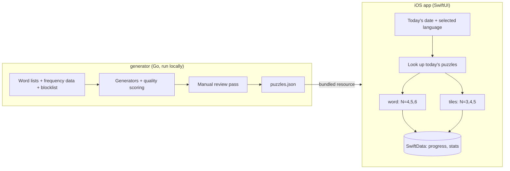

# N-grams design

Status: draft. The generator and the app cover `word` and `tiles` (2026-10-24)

## Goal

Daily word puzzles on iPhone without ads, accounts, energy meters, or upsells. Two game types
modeled on games I already like (NYT Wordle and Apple News Quartiles), each offered at three
sizes, so N varies, in English and Spanish. Six puzzles a day per language, every day.

Built to launch publicly on the App Store. What a launch still needs:

- A third game modeled on NYT Spelling Bee (`pangram`).
- An app icon.
- Final names for the app and the games (see [Open questions](#open-questions)).
- Stats, streaks, and the emoji share.

## Non-goals (for now)

- Accounts, sync, leaderboards, notifications.
- A puzzle archive or "play unlimited" mode.
- Live puzzle generation on the device.
- Monetization of any kind.
- Translating the app's own text. Puzzles are bilingual; the app around them stays English.

## Games

The originals' names are trademarks (WORDLE is NYT's, Quartiles is Apple's) and must not appear
in the app. The in-app names are placeholders for now: "Word" and "Tiles", under the app name
"N-grams". Internally the kinds are `word` and `tiles`.

| Kind    | Modeled on | Sizes (N)          | Daily puzzles |
| ------- | ---------- | ------------------ | ------------- |
| `word`  | Wordle     | 4, 5, 6 letters    | 3             |
| `tiles` | Quartiles  | 3, 4, 5 tiles/word | 3             |

### `word`

- Guess an N-letter word; each guess marks letters as correct, present, or absent. A
  misplaced letter is marked present only as many times as the answer has it left over after
  its correct letters, as in the original.
- 6 guesses at every N to start. Shorter words are the trap-prone ones (BATE/DATE/FATE/GATE),
  so scaling guesses as N+1 would make the hardest variant harder. Tune by playing.
- Guesses must come from the accepted-guess list for that length: every dictionary form,
  plurals and conjugations included. A blocked word gets "How dare you", as in `tiles`.
- The app has its own keyboard; the Spanish one adds Ñ. A lost puzzle shows the answer with
  its accents.
- Solving earns the star. A puzzle is completed once it's over, won or lost, and its row
  shows the guesses used ("4/6", "X/6").

### `tiles`

- A board of word fragments ("tiles"). Build words from 1 to N tiles, each tile used at most
  once per word, in order.
- Each board hides target words of exactly N tiles that together use every tile: 7, 5, and 4
  targets at N=3, 4, 5, so every board has about 20 tiles (21, 20, 20).
- Holding the tile count near 20 beat 5 targets at every N (15/20/25 tiles) in the prototype.
  At N=3, 15 tiles can't produce 40 common words in either language; 21 can. At N=5, 20 tiles
  reach the same word counts as 25, so the extra tiles are clutter. A constant tile count also
  means one board layout on the phone instead of three.
- The board has N columns, so 21 or 20 tiles always fill a rectangle (7×3, 5×4, 4×5) and a
  solved target fills exactly one row.
- The app lays tiles out, not the bank: a uniform shuffle left two of a target's tiles side by
  side, in order, on about half of all boards. A row holds at most one tile of any target at
  N=3 and 4 (two at N=5, where five tiles from four targets must repeat one), and no target's
  tiles sit side by side in reading order. The app redraws random layouts until one passes
  (about 1 in 300 at N=4, so microseconds), seeding the first by board so it's stable across
  launches. Shuffle redraws the unsolved tiles; solving a target leaves the rest to slide up
  as in the original.
- A board's star takes every target and the target score.
- As in the original, a found target's tiles lock into a row at the top of the board and stay
  usable in other words. A global "hard mode" setting takes them off the board instead. Since
  every tile belongs to a target, finishing the last target empties the board, so in hard mode
  the 20 points beyond the targets and bonus have to come before the last target.
- Scoring borrows the original's curve. Quartiles (per Apple's help page, checked 2026-10-23)
  scores 1, 2, 4, and 8 points for words of 1 to 4 tiles, adds 40 for finding all five
  Quartiles, and calls 100 points "Expert". Here a word of k tiles scores 2^(k-1) at every N,
  finding every target adds 40, and the target score is every target plus the bonus plus 20:
  88, 100, and 124 at N=3, 4, 5, which reproduces the original at N=4. The generator writes
  each word's points, the bonus, and the target score into the bank, so retuning is a bank
  rebuild rather than an app release.

### Shared

- The day rolls over at local midnight on the device.
- Home lists every puzzle for the day on one screen, a section per game and size ("Tiles ·
  N=3"), each holding both languages marked by flag (🇺🇸, 🇲🇽 for the American and Mexican word
  lists). Sections are per game as well as size because N counts tiles in one game and letters
  in the other. Completed puzzles move to a "Completed" section at the bottom: a `tiles`
  board once it has its star, a `word` puzzle once it's over.
- Players choose which languages they want puzzles in, once on first launch (pre-checked from
  the device's preferred languages) and any time after in Settings. Home shows only those, so
  nobody is handed puzzles in a language they don't play. At least one stays on.
- Results can be shared as an emoji summary (no spoilers).
- Stats and streaks are per `(lang, kind, n)`.

## Languages

English and Spanish (`en`, `es`). Each language gets its own full daily set, so 12 puzzles a
day, and a switch in the app moves between them.

- **Region.** Spanish means `es_MX`: dictionary, commonness judgments, and blocklist.
- **Accents fold.** For matching and scoring, á/é/í/ó/ú/ü count as their plain vowels in both
  games. `tiles` forces this: CANCIÓN and CANCIONES would otherwise need different tiles for
  the same fragment. Whole words (the revealed `word` answer, the `tiles` found-words list)
  display with their accents.
- **Ñ is its own letter.** N and Ñ score separately. The Spanish keyboard has an Ñ key and no
  accent keys.
- **Digraphs are two letters.** CH, LL, and RR count as two letters each, per current RAE
  spelling.
- **Base forms as answers.** `word` answers and `tiles` targets are infinitives, singular nouns,
  and masculine singular adjectives. Every inflected form is still a valid guess or found word.
  A Spanish verb has around 50 forms, so without this rule a large share of answers would be
  conjugations.
- Sizes and guess counts match English to start. Tune by playing.

The generator does the folding, so the app only compares plain strings: tiles and accepted
guesses ship folded, and each word carries its accented spelling for display.

## Architecture

The app plays puzzles; it never makes them. All generation and curation happens offline in a
Go tool, and the app ships with a pre-built puzzle bank.



### Repo layout

```text
generator/   Go module: word list processing, puzzle generation, bank output
ios/         Xcode project
data/        per-language source word lists and blocklists, generated bank
docs/        this file
```

`make format lint test` covers every part of the repo. `make bank` rebuilds the bank.

## Generator

The generator takes a list of languages and runs the same pipeline once per language. What
differs between them (word sources, folding, banned fragments, the base-form rule) lives in
per-language config.

### Word lists

- English dictionary: ENABLE (public domain). SCOWL (permissive) if ENABLE proves too sparse or
  too obscure. NYT's own lists are not usable.
- Spanish dictionary: the RLA-ES `es_MX` Hunspell dictionary, licensed GPLv3+, LGPLv3+, or
  MPL 1.1+ at our choice, and actively maintained. Hunspell stores stems plus affix rules, so
  the generator expands them into full forms (`unmunch`, or a small Go affix expander). The
  `.dic` stems are close to lemmas and may seed the base-form answer list; irregular verbs
  probably break that, unverified.
- Mexican Spanish uses neither voseo nor vosotros, but a few of `es_MX`'s affix rules and
  stems produce them (`tené`, `adquiríais`, `dadle`). The generator drops those rules and stems
  by name, and fails if a dictionary update removes one, so a renamed rule can't sneak back.
- Commonness: subtitle word counts from hermitdave/FrequencyWords (OpenSubtitles 2018), not
  Google Books Ngram. English reads the top 50k list. Spanish reads the full list (1.2M lines),
  since the 50k list misses rare but standard inflections (`untó`, `vencía`); the dictionary
  filters out the junk in its tail. In both languages targets come only from the top 50k
  ranks, and a found word counts as common at 20 or more occurrences.
- Blocklist: one per language, in `data/blocklists/`. Offensive words are excluded from
  answers and targets, and the board search penalizes boards that can spell them. A board
  that still can lists them apart from its scoring words, and spelling one gets "How dare you"
  instead of points: a plain rejection of a real word would read as a bug. The bar is slurs,
  sexual or anatomical vulgarity, and sexual-violence terms; words whose innocent sense
  dominates stay (sexual, suck, butt, Spanish pedo), and mild profanity (damn, hell, crap)
  stays except "ass". Spanish entries are stems, so blocking one blocks every form it
  expands to; English entries are exact forms, so compounds need their own entries. Stems
  also mean a Spanish word can only be blocked with its whole family: mamar takes mamá with
  it and violar takes viola, so their vulgar forms (mame, violen) stay unblocked until the
  list supports exact forms.

### `word` puzzles

Pick one answer per length per day at random from the 1,500 most common answers of that
length, without repeats within a language. Each kind draws from its own random stream, so
adding word puzzles left every `tiles` board as it was. Accepted guesses per length come
from the full dictionary.

Answers are base forms, which neither dictionary marks directly:

- English drops a target that is another word plus "s", "ed", or "d" (CATS, BAKED, FREED),
  except words ending in "ss". ENABLE has no lemmas, so this guesses, and it also drops some
  base forms (NEED, from NEE). Gerunds (TIRING, ASKING) stay.
- Spanish takes the `.dic` stems that carry affix flags. The flagless ones are mostly
  irregular conjugations and abbreviations (seré, podrán, dpto). A stem displays as the
  dictionary spells it rather than as its most common homograph (vera, not verá), which also
  changed a few `tiles` words' display spellings.
- At 4 letters Spanish has only about 720 answers, under 2 years of puzzles.

### `tiles` puzzles

1. Pick the target words (7, 5, or 4) that split cleanly into N fragments.
2. Choose a segmentation for each.
3. Enumerate every valid word buildable from 1 to N tiles, using a trie to prune.
4. Score the board and keep the good ones for review.

Enumeration cost is not a concern at these sizes: 20 tiles with 5-tile words is small once
a trie prunes dead prefixes.

What makes a board good is the real question, and it is not "most words":

- **Fragment shape.** Short fragments ("in", "er") combine with everything and produce
  hundreds of junk words. Fragments are at least 2 letters (the original rarely if ever uses
  1-letter tiles), at most 4 to start, and never on a banned-fragment list. These are filters on
  the candidate segmentations, applied before any search, and they matter more than the search
  strategy itself. Banned-fragment lists are per language, and Spanish's will be longer:
  inflectional suffixes (`ar`, `os`, `as`, `mos`, `ron`) attach to nearly every stem. Cuts
  land anywhere, so some tiles are unpronounceable (`ysan`, `rpri`, `nsp`); that's fine, so
  there is no syllable alignment.
- **Frequency-weighted word count.** Count found words weighted by how common they are, inside
  a target range rather than maximized. The range starts at 40 to 80 common words at every N.
  40 is the highest floor N=3 comes close to reliably: in the 90-day bank, 47 of 180 N=3
  boards (30 English, 17 Spanish) land at 35 to 39, which the generator logs as a warning.
  Whether N=4 and N=5 want a higher floor of their own is for playtesting to decide. Boards
  settle near the floor, because the penalty for obscure words pulls the count down once it's
  in range.
- **Target uniqueness.** The targets should be the only N-tile words on the board, or "find
  all the full-length words" becomes ambiguous.
- **Not trivially guessable.** Fragments should be ambiguous enough that targets aren't
  obvious at a glance.

### Search strategy: heuristic first, solver if needed

Choosing segmentations to optimize the board can be stated as weighted MaxSAT or an integer
program: one boolean per candidate segmentation, exactly one per target, a derived word "exists"
only if all its tiles are chosen, uniqueness as a hard constraint, the frequency-weighted score
as the objective. A solver (OR-Tools CP-SAT is the mainstream choice) would return provably
optimal boards.

Starting with generate-and-test instead:

- n is small. About 1,100 boards a year, generated offline, with no time limit worth caring
  about. Random sampling plus local search over segmentations, scored and ranked, is likely
  good enough.
- Optimality only helps once the objective is right, and the objective is the part we don't
  know yet. Playing heuristic boards is how we find it.
- CP-SAT does have a Go API in the OR-Tools repo (`ortools/sat/go/cpmodel`, actively maintained),
  but it is a cgo wrapper over the C API that OR-Tools builds with Bazel, and the README doesn't
  document it. Using it from a plain `go build` means getting the native library and headers
  installed and linked first; that setup cost is unmeasured.

Reach for a solver if heuristic boards come out consistently mediocre and the scoring rules can
be stated precisely. Segmentation with targets already fixed is the part it suits best.

## Puzzle bank

Plain JSON at `data/bank/puzzles.json`, committed, bundled in the app as a resource, and
decoded with `Codable` at launch. 90 days in both languages is about 1.5 MB, so a year is
roughly 3 MB per language, almost all of it the precomputed valid-word lists for `tiles`
boards. The generator computes those lists so the app never has to work them out, and so the
review pass covers exactly what the app will accept.

`make bank` rebuilds it from a fixed start date, length, and seed set in the Makefile; the same
seed and source data rebuild the same bank. No target repeats within a language. Tiles are
shuffled, though the app lays them out itself. Each day sits in its own block with one word
per line, so a rebuilt bank diffs by eye; `make bank ARGS=-print` prints every board for review.

Accepted `word` guesses ship as one newline-separated text file per `(lang, n)` in
`data/bank/guesses/` (`en-5.txt`), with that length's blocked words beside it
(`en-5-blocked.txt`), loaded into a `Set<String>` when a puzzle opens.

The format (puzzles are a list per day, so adding a language, kind, or size is additive).
`display` appears only when the accented spelling differs from the folded one. `blocked` lists
the folded spellings of offensive words the tiles can build, and appears only when there are
any.

```json
{
  "version": 1,
  "seed": 1,
  "days": [
    {
      "date": "2027-01-01",
      "puzzles": [
        { "lang": "en", "kind": "word", "n": 4, "answer": "lamp" },
        { "lang": "es", "kind": "word", "n": 5, "answer": "arbol", "display": "árbol" },
        {
          "lang": "en",
          "kind": "tiles",
          "n": 3,
          "tiles": ["sta", "ple", "ham", "..."],
          "targets": [[0, 4, 9], "..."],
          "bonus": 40,
          "target_score": 88,
          "blocked": ["..."],
          "words": [{ "word": "staple", "tiles": [0, 1], "points": 2 }, "..."]
        }
      ]
    }
  ]
}
```

### Why not SQLite

- The bank is small, read-only, and only ever looked up by date.
- Apple's frameworks only open SQLite files in Core Data's own internal layout, which a Go tool
  can't easily produce, so a Go-built database means the C API or a dependency (GRDB). That buys
  nothing at this size.
- JSON can be reviewed and diffed by eye during curation.

Revisit if the bank grows to tens of MB (a many-year archive); split per year or move to SQLite then.

### Two stores, kept apart

| Store         | Contents                       | Written by        | Lives in      |
| ------------- | ------------------------------ | ----------------- | ------------- |
| Puzzle bank   | Puzzles, accepted words        | Generator (build) | App bundle    |
| User progress | Guesses, scores, streaks       | App (runtime)     | SwiftData     |

The only link is the key `(lang, kind, n, date)`. Shipping a new bank never touches user data, and
moving the bank from "bundled" to "fetched from a static URL behind Caddy, cached on device,
bundled copy as fallback" changes nothing about the format.

## Distribution and legal

- Personal install via Xcode for now, signed with my existing paid developer team, so a
  development build keeps launching for the year its provisioning profile lasts rather than
  the 7 days a free account allows. TestFlight builds expire after 90 days.
- Going public means no use of any original's name, and a visual design that is
  clearly its own. App Review guideline 4.1 (copycats) can reject apps that look too much like
  an existing game, and NYT pursued Wordle clones in 2022.
- "N-grams" is not taken on the US App Store (checked 2026-10-19), but App Store search for
  "n-grams" returns kitchen scales, so the name helps nobody find it.

## Open questions

1. In-app names for the two game types. "Word" and "Tiles" are placeholders.
2. Whether the `tiles` scoring curve and target scores above play well; tune by playing.
3. Whether the `es_MX` `.dic` stems are good enough as the Spanish base-form list, or a real
   lemma source is needed. On the boards seen so far, stems as targets read like base forms
   (`musulmán`, `envenenamiento`), including `-mente` adverbs, which the dictionary stores as
   stems.

## Milestones

Whether boards are fun gets judged by playing them in the app, installed on my phone, not by
reading printed output. So the order is:

1. `tiles` playable on my phone with real generated boards, in both languages. A Debug-only
   day picker steps through the whole bank, so a playtest isn't limited to one day's boards.
2. `word`.
3. `pangram`.
4. The app icon.
5. Stats, streaks, and the emoji share.
